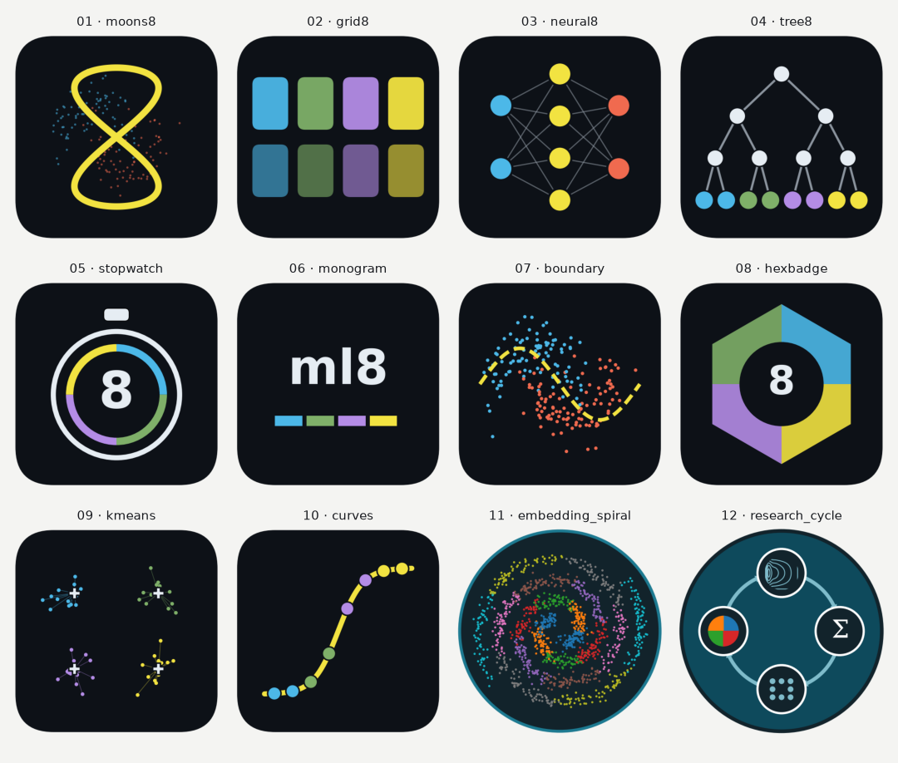

<p align="center">
  <picture>
    <source media="(prefers-color-scheme: dark)" srcset="images/logo-wide-dark.png">
    
  </picture>
</p>

# Eight ML Algorithms, Slowed Down

[](https://github.com/Djeutsch/ml-algorithms/actions/workflows/deploy.yml)

An interactive dashboard and a Jupyter Book that unpack an "8 algorithms · under 60 seconds"
video: linear regression, logistic regression, decision tree, random forest, gradient
boosting, k-nearest neighbours, k-means and a neural network. Each is run on small, seeded
sample data, and the dashboard and book always show the same numbers.

| | Live link | Source |
|---|---|---|
| 📘 Jupyter Book | https://djeutsch.github.io/ml-algorithms/ | `myst.yml`, `intro.md`, `notebooks/`, `src/`, `ml8/` |
| 📊 Dashboard | https://djeutsch.github.io/ml-algorithms/dashboard/ | `dashboard/` |

Both are deployed to GitHub Pages by `.github/workflows/deploy.yml` on every push to `main`.

---

## Quick start

```bash
git clone https://github.com/Djeutsch/ml-algorithms.git
cd ml-algorithms
python -m venv .venv
source .venv/bin/activate          # Windows: .venv\Scripts\activate
pip install -r requirements.txt

jupyter book start                 # book with live reload → http://localhost:3000
python -m http.server 8000         # dashboard            → http://localhost:8000/dashboard/
```

Run the two servers in separate terminals. The details are below.

### Prerequisites

- Python 3.10+ (tested on 3.12 and 3.13)
- Node.js 18+ (Jupyter Book 2 uses it to build the site and offers to install it if missing)
- Git

---

## The dashboard

### Run it

The dashboard is a static page (HTML, JavaScript and CSV files, with d3 vendored in
`dashboard/vendor/`), so it needs no build step and no internet connection. Browsers block
`fetch` from `file://` URLs, so **serve it over HTTP** rather than double-clicking
`index.html`:

```bash
python -m http.server 8000         # from the repository root
# open http://localhost:8000/dashboard/
```

Stop the server with <kbd>Ctrl</kbd>+<kbd>C</kbd>. Any other port works (`python -m http.server 9000`).

### Use it

1. **Overview** (top of the page): the test accuracy of every classifier on the shared
   two-moons sample, and a scorecard with each algorithm's headline metric.
2. **Pick an algorithm** in the 4 × 2 grid. Buttons are coloured by family, as in the video:
   blue = linear, green = trees, purple = distance-based, yellow = neural network.
3. **Play with its control.** Each panel shows the formula, a control and live statistics:

   | Algorithm | Control | What to watch |
   |---|---|---|
   | Linear regression | gradient-descent step slider, **Play** | the line swinging into place, MSE falling |
   | Logistic regression | gradient-descent step slider, **Play** | the sigmoid sharpening, log-loss falling |
   | Decision tree | maximum depth | split lines; table of every split's Gini |
   | Random forest | number of trees | the averaged surface, plus nine member trees |
   | Gradient boosting | trees added so far | misclassified points (ringed) disappearing |
   | K-nearest neighbours | number of neighbours *k*; **click the chart** | the query point's neighbours and vote |
   | K-means | number of clusters, iteration | centroids moving; elbow chart |
   | Neural network | training epoch | decision surface, loss curve, weight diagram |

4. **Hover** any chart for exact values.
5. **Share a view:** each tab has its own link, for example `…/dashboard/#knn`.

The dashboard follows your system's light or dark setting. The **← Companion Jupyter Book**
link at the top goes to the book when both are served together (see below).

---

## The Jupyter Book

The notebooks in `notebooks/` are stored **with outputs**, so you can preview or build the
book without running any code.

### Preview while you write

```bash
jupyter book start                 # http://localhost:3000, reloads when files change
```

### Build the static site

```bash
jupyter book build --html          # writes _build/html
```

### Serve the book and dashboard together (exactly as GitHub Pages does)

```bash
jupyter book build --html
cp -r dashboard _build/html/dashboard
python -m http.server 8000 -d _build/html
# book: http://localhost:8000/      dashboard: http://localhost:8000/dashboard/
```

To clear old builds: `jupyter book clean` (or delete `_build/`).

### Open a chapter as a notebook

```bash
pip install jupyterlab
jupyter lab notebooks/
```

---

## Change the content

All data comes from the `ml8` package, so you can change a setting and rebuild both outputs:

```bash
python scripts/build_notebooks.py               # src/*.py → executed notebooks/*.ipynb
python scripts/build_notebooks.py 06_knn        #   …or just one chapter
python scripts/export_dashboard_data.py         # → dashboard/data/*.csv
python scripts/build_standalone_dashboard.py    # dashboard/page.html → dashboard/index.html
```

- Edit chapters in `src/` (Jupytext percent scripts). `notebooks/` is generated from them,
  so edits made directly to the notebooks are overwritten.
- Model settings live in `ml8/models.py` and datasets in `ml8/data.py`.
- Each chapter starts with a visible **Imports** section: a table of the `ml8` functions it
  uses and a cell importing only what the chapter needs. If you use something new in a
  chapter, add its import to that cell and update the table.
- Commit the regenerated `notebooks/` and `dashboard/` files. CI builds the book from the
  stored outputs and doesn't re-execute anything.

## Change the logo

There are twelve logos to choose from, and each has a wide version for the book, in one file
per theme, in `images/logos-wide/`. Compare them in
[`logos/contact_sheet_wide.png`](logos/contact_sheet_wide.png), then install one by name:

```bash
python scripts/generate_logos.py --list            # the available names
python scripts/generate_logos.py --use hexbadge    # switch the book and dashboard to this logo
jupyter book build --html                          # rebuild (or just reload `jupyter book start`)
```

`--use` copies that logo over `images/logo-wide-light.*`, `images/logo-wide-dark.*`,
`images/logo.*` and `dashboard/logo.png`, and updates both favicons. `myst.yml` doesn't need
to change. To go back, run `--use stopwatch`.

To try a logo in the book only, point `myst.yml` straight at its files instead:

```yaml
logo: images/logos-wide/hexbadge-light.svg
logo_dark: images/logos-wide/hexbadge-dark.svg
```

**Add your own:** save it as `logos/candidates/NN_<name>.svg` and `.png` (square, with a
transparent background) and run `python scripts/generate_logos.py`. It gets wide versions and
works with `--use` like the others, as `embedding_spiral` and `research_cycle` do.

The wide logos' text is set in `render_wide()` in `scripts/generate_logos.py`. Only
`stopwatch` has a favicon simplified for 16 px; other logos are scaled down as they are, so
detailed ones won't read well in a browser tab.

The current logo is **stopwatch**: an 8 on a stopwatch dial ringed in the four family
colours, for "eight algorithms, slowed down".



## Change the page layout

- **Logo, search bar and sidebar:** `book.css` puts the logo and search at the top of a
  full-height left sidebar. On screens narrower than 1280 px the theme's top bar stays, with
  the sidebar in its menu. The rules depend on the theme's class names and grid, so check the
  layout if you change the `jupyter-book` version in `deploy.yml`.
- **Footer:** the author line and licence badges are in `footer.md`. The author is also set
  under `authors` in `myst.yml`.

---

## Repository layout

```
.
├── myst.yml, intro.md          Jupyter Book 2 (MyST) configuration and landing page
├── book.css                    page layout: logo and search in the sidebar, footer
├── footer.md                   author line and licence badges under every page
├── notebooks/                  executed chapters 00–09 (generated)
├── src/                        chapter sources (Jupytext percent format)
├── ml8/                        shared code: data, from-scratch formulas, models, plot style
├── scripts/
│   ├── build_notebooks.py           src/ → executed notebooks/
│   ├── export_dashboard_data.py     ml8 → dashboard/data/*.csv
│   ├── build_standalone_dashboard.py  page.html → index.html
│   └── generate_logos.py            logo candidates, wide versions, install the chosen one
├── images/                     the current logo, favicon and licence badges
│   └── logos-wide/             wide version of every logo, for light and dark themes
├── logos/                      square logo candidates and contact sheets
├── dashboard/
│   ├── index.html              standalone dashboard (generated)
│   ├── page.html               dashboard page, wrapped into index.html
│   ├── dash-runtime.js         tiny runtime that loads the CSVs and runs the page's drawings
│   ├── data/                   the 18 sample-data CSV files
│   └── vendor/                 d3 v7.9.0
└── .github/workflows/deploy.yml   builds the book and publishes both to GitHub Pages
```

## Deployment

`.github/workflows/deploy.yml` runs on every push to `main` (or manually from the
**Actions** tab). It builds the book with `BASE_URL=/<repo>` so links work under the
repository path, copies `dashboard/` into the site and publishes it to GitHub Pages.

To deploy your own fork:

1. Fork or push this repository to GitHub.
2. **Settings → Pages → Build and deployment → Source: GitHub Actions.**
3. Replace `Djeutsch/ml-algorithms` and `djeutsch.github.io/ml-algorithms` in `README.md`,
   `intro.md` and `myst.yml` with your user and repository name.
4. Push to `main`. The site appears at `https://<user>.github.io/<repo>/`.

## Troubleshooting

| Symptom | Fix |
|---|---|
| Dashboard shows empty panels or "failed" markers | You opened it as a `file://` URL. Serve it with `python -m http.server`. |
| `jupyter book` is not a command | Activate the virtual environment, or install with `pip install -r requirements.txt`. |
| `jupyter book start` asks to install Node.js | Accept, or install Node.js 18+ yourself. |
| Port already in use | Use another port: `python -m http.server 8001`, `jupyter book start --port 3001`. |
| macOS: `git` says "You have not agreed to the Xcode license" | Run `sudo xcodebuild -license accept` once. |
| Deployed book has broken links or missing CSS | Pages source must be **GitHub Actions**, and the repository name must match the URL path. |

## About the data

Everything is synthetic sample data: scikit-learn's `make_moons` and `make_blobs`, plus two
small NumPy-generated 1-D sets, all seeded. The numbers illustrate how each algorithm
behaves; they are not benchmarks.

By Laique M. Djeutchouang. License: CC BY 4.0 for text and figures, MIT for code.
